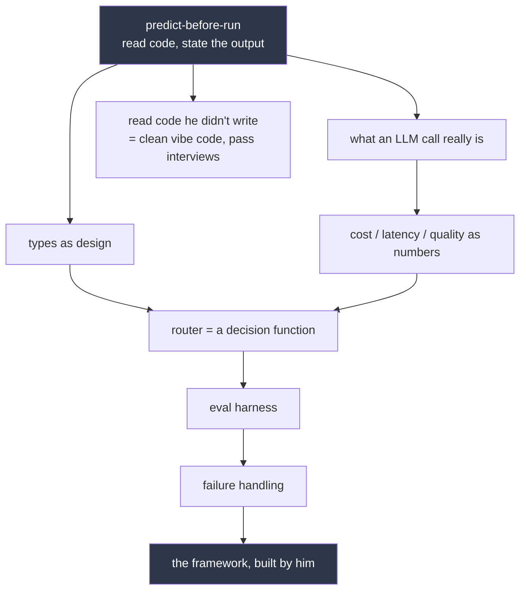

# 2026-09-21 — predict-before-run

First session of Track 1 (systems). Also the first overdue review run.

## Why this node

He asked to be made capable of four things: designing an LLM router framework, reverse-engineering a model from a paper without AI, getting hired, and cleaning up vibe code. They are not four. They share one root — being able to say what code or a system will do *before* running it. Everything else is built on that.



## What happened

**Review — `chain-of-support`, 13 days overdue: failed.**
Factory case: the gauge that measures rod length breaks, dial still works. Can the worker still improve? He said yes — "he will have to get many tries", learning by feel and timing. That is `more-data-fixes-everything` surfacing a third time, now outside ML entirely.

Took two conflict rounds. The first scenario I built was flawed — I bolted the dial to remove drift, which also removed his ability to adjust at all, so "he can't dial" became a fair reading. My error; rebuilt it with a freely-turning dial and no measuring instrument anywhere.

He then named the right thing himself — "no way to tell if it was the right length" — but kept attaching **yes** to it. The residual gap was definitional: he treated *passing through* the target as *arriving at* it. Closed by pointing out that arriving requires stopping, and stopping requires knowing you are there.

`proxy-signal` review was spoiled before it ran — I quoted the mirror-fogs answer at him earlier in the conversation. Re-queued untested.

**New — the code trace.**

```python
a = [1, 2]
b = a
b.append(3)
x = 10
y = x
y += 1
print(a, x)
```

He answered `2, 10`. Two stacked errors, and two real wins underneath them.

Wins, and they are the hard half: he tracked that appending through `b` changed `a` (shared object), *and* that `y += 1` left `x` alone (numbers not shared). He held both asymmetric cases at once and said why.

Errors, both surface: he read `print(a, x)` as printing a **length** — a word that appears nowhere in that code — and he computed that length as 3 items → 2, merging *count* with *index*.

The two wrong answers shared one move: a gap appeared and he filled it with something plausible instead of checking what was written. Named for him explicitly as a habit, not an intelligence problem, with the fix being bookkeeping — track the values, add nothing unwritten.

**Production.** Predicted `[70, 80, 90, 100] / 4 / 100` — correct, but only after being pushed to commit; he had reasoned it right mid-sentence then written "not sure". Then the deliberately-broken variant with `list(scores)`: `[70, 80, 90] / 3 / 90`, correct, committed with no hedge. Both run and confirmed.

## Standing observation

His reasoning was right and his confidence was wrong. That is two separate skills and today only one of them was failing. Make him commit before revealing, always — machine grading is what fixes this, not reassurance.

## Vocabulary added (8)

value, variable, list, append, output, index, len, `list(a)` — all in `state/glossary.md`. He asked for vocabulary very slowly, a few per session, defined before use.

## Queued next

More `predict-before-run` reps on unseen code, then: what an LLM call really is → types as design → routing as a decision function → eval harness → failure handling.

Rule agreed: AI may explain anything, but may not produce the artifact.
